# Credit Management System: Business Architecture, Processes and Data Model (Detailed Design)

| Item | Value |
| --- | --- |
| Document | Detailed business design |
| Version | 0.1 (draft) |
| Date | 2026-11-16 |
| Scope | Corporate, SME and retail credit; on-balance-sheet loans and off-balance-sheet facilities (guarantees, L/Cs) |
| Related | [Departments and Roles](departments-and-roles.md) |

This document defines the business design of the Credit Management System (CMS): what it is responsible for, how each business process runs step by step, and what data it keeps. It is written for business analysts, architects, developers and testers, and is the basis for functional specifications and the physical database design.

## Contents

1. [Conventions](#1-conventions)
2. [Business architecture](#2-business-architecture)
3. [Main business processes](#3-main-business-processes)
4. [Business data model](#4-business-data-model)
5. [State machines](#5-state-machines)
6. [Business events](#6-business-events)
7. [Business rules catalog](#7-business-rules-catalog)
8. [Open questions](#8-open-questions)

---

## 1. Conventions

| Prefix | Meaning | Example |
| --- | --- | --- |
| `C-` | Business capability | C-04 Credit approval |
| `P-` | Business process | P-02 Corporate credit approval |
| `BR-` | Business rule | BR-LIM-003 Limit occupation check |
| `E-` | Business event | E-LOAN-DISBURSED |
| `ST-` | Status code | ST-APP-SUBMITTED |

- **Amounts** are stored as `decimal(20,2)` in the transaction currency, plus a reporting-currency equivalent where noted.
- **Dates** are `date` (business date). **Timestamps** are `timestamp with time zone`.
- **Required** column: `Y` = mandatory, `N` = optional, `C` = conditional (rule given in the description).
- **Maker-checker** means one user enters or proposes, and a different user with the right authority confirms.

---

## 2. Business architecture

### 2.1 Context

The CMS is the bank's system of record for **credit decisions, limits, collateral, contracts and credit risk status**. The core banking system remains the system of record for **accounts and accounting balances**.

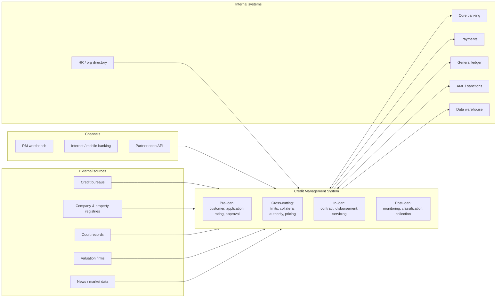

### 2.2 Capability map

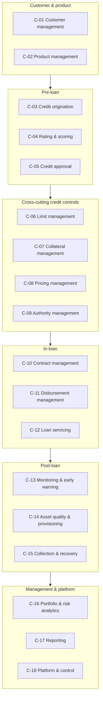

### 2.3 Capability definitions

| ID | Capability | Level-2 capabilities | Business owner | Key outputs |
| --- | --- | --- | --- | --- |
| C-01 | Customer management | Onboarding & KYC; individual and organization profile; group & related parties; financial statements; external reports; customer 360° view | Front office | Customer record, group tree |
| C-02 | Product management | Product catalog; parameters; rate & fee schemes; eligibility rules; lifecycle (draft, launched, retired) | Product / Risk | Product definition |
| C-03 | Credit origination | Application intake; document checklist; due diligence report; financial analysis; credit proposal | Front office | Credit application |
| C-04 | Rating & scoring | Customer rating (PD); facility rating (LGD/EAD); retail scorecard; override; periodic re-rating | Risk | Rating record |
| C-05 | Credit approval | Routing; review; delegated approval; committee; conditions; reconsideration | Credit Approval | Approval decision |
| C-06 | Limit management | Limit tree; activation; occupation & release; freeze; adjustment; concentration caps | Risk / Credit Admin | Active limit, limit transactions |
| C-07 | Collateral management | Registration; valuation; allocation; perfection; insurance; monitoring; release | Credit Admin | Collateral, LTV |
| C-08 | Pricing management | Base rates; pricing grid by rating; risk-adjusted pricing; pricing exceptions | Risk / Treasury | Approved price |
| C-09 | Authority management | Authority matrix; delegation; temporary authority; authority audit | Risk / CCO | Required approval level |
| C-10 | Contract management | Templates; generation; signing; amendment; archive | Credit Admin / Legal | Effective contract |
| C-11 | Disbursement management | Drawdown request; conditions checklist; disbursement approval; entrusted payment | Credit Admin | Loan account |
| C-12 | Loan servicing | Schedule; accrual; repayment; prepayment; extension; rate reset | Operations | Balances, schedule |
| C-13 | Monitoring & early warning | Scheduled reviews; covenant tests; warning signals; watch list | Monitoring | Monitoring report, actions |
| C-14 | Asset quality & provisioning | Risk classification; IFRS 9 staging; ECL; impairment assessment | Risk / Finance | Classification, ECL |
| C-15 | Collection & recovery | Delinquency buckets; strategies; actions; litigation; enforcement; restructuring; write-off | Collections / Legal | Recovery, write-off |
| C-16 | Portfolio & risk analytics | Concentration; stress testing; RWA; limit utilization; vintage analysis | Risk | Risk reports |
| C-17 | Reporting | Regulatory reports; management dashboards; RAROC | Finance / Reporting | Reports |
| C-18 | Platform & control | Workflow; rules; models; users, roles & data scope; audit; documents; notifications; batch | IT | Platform services |

### 2.4 Business domains (module boundaries)

Each domain owns its data. Other domains read it through services or events and do not update it directly.

| Domain | Owns (master data) | Consumes from |
| --- | --- | --- |
| Party | Customer, group, related party, financial statement | AML, credit bureau, registry |
| Product | Product, parameter, rate & fee scheme | — |
| Origination | Application, facility request, due diligence report | Party, Product, Rating |
| Rating | Rating model, rating record | Party (financials), external data |
| Approval | Approval task, opinion, decision, condition | Origination, Authority |
| Authority | Authority matrix, delegation | Org directory |
| Limit | Limit, limit transaction, freeze | Approval, Contract, Loan |
| Collateral | Collateral, valuation, link, registration, insurance | Party, valuation firms |
| Contract | Loan, security and guarantee contracts | Approval, Limit, Collateral |
| Loan | Drawdown, schedule, transaction, accrual | Contract, Limit, core banking |
| Monitoring | Monitoring task, report, warning signal, covenant | Party, Loan, external data |
| Asset quality | Classification, ECL result | Loan, Rating, Monitoring |
| Collection | Delinquency case, action, promise, litigation, write-off | Loan, Collateral |

### 2.5 Organization-to-capability mapping (RACI)

R = responsible, A = accountable, C = consulted, I = informed.

| Capability | RM / Front | Credit Approval | Risk Mgmt | Credit Admin | Operations | Collections | Legal | Finance | Compliance |
| --- | --- | --- | --- | --- | --- | --- | --- | --- | --- |
| C-01 Customer | R/A | I | I | I | — | — | — | — | C |
| C-03 Origination | R/A | C | I | — | — | — | — | — | — |
| C-04 Rating | R | C | A | — | — | — | — | — | — |
| C-05 Approval | C | R/A | C | I | — | — | C | — | C |
| C-06 Limit | I | C | A | R | — | — | — | — | — |
| C-07 Collateral | C | C | I | R/A | — | — | C | — | — |
| C-10 Contract | C | I | — | R/A | — | — | C | — | — |
| C-11 Disbursement | C | I | — | R/A | C | — | — | I | — |
| C-12 Servicing | I | — | — | C | R/A | — | — | I | — |
| C-13 Monitoring | R | I | A | — | — | — | — | — | — |
| C-14 Asset quality | C | C | R/A | — | — | — | — | R | — |
| C-15 Collection | C | I | C | — | — | R/A | R | I | — |

### 2.6 Architecture principles

| # | Principle | Design consequence |
| --- | --- | --- |
| AP-1 | One credit view per customer and group | Every exposure type (loan, guarantee, L/C, bill, card) occupies the same limit tree |
| AP-2 | Approval, contract and drawdown are separate objects | Three entities, each with its own status; one approval can back many contracts, one contract many drawdowns |
| AP-3 | Segregation of duties is enforced by the system | Role-conflict rules; the same user cannot act twice on one case in incompatible roles |
| AP-4 | Business behavior is configured, not coded | Products, routes, authority, rules, checklists and models are versioned parameter data |
| AP-5 | Every change is traceable | Immutable audit log; history tables for rating, classification, valuation, limit |
| AP-6 | Events drive downstream updates | Key events published to a message bus; reports and other domains subscribe |
| AP-7 | Core banking is the accounting master | CMS reconciles balances daily and never posts accounting entries outside the agreed interface |

---

## 3. Main business processes

### 3.1 Process map

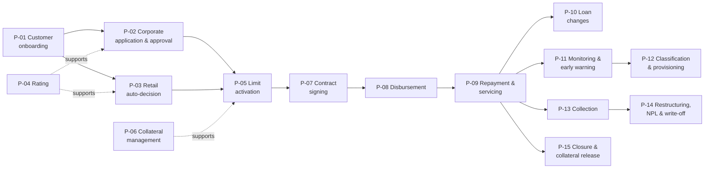

| ID | Process | Trigger | Main actors | Output | Target time |
| --- | --- | --- | --- | --- | --- |
| P-01 | Customer onboarding & maintenance | New customer; data change | RM, Compliance, reviewer | Active customer | 1 business day |
| P-02 | Corporate credit application & approval | Financing need; renewal; increase | RM, analyst, approvers, committee | Approval decision | 5–15 business days by level |
| P-03 | Retail credit application (auto-decision) | Online or branch application | Customer, system, underwriter | Approve / decline / refer | Seconds (auto); 1 day (manual) |
| P-04 | Rating & re-rating | New application; annual review; trigger event | RM, risk analyst | Rating record | Within P-02 |
| P-05 | Limit management | Approval; change; freeze; expiry | Credit Admin, risk | Limit status change | Same day |
| P-06 | Collateral management | Collateral offered; revaluation due; release | Credit Admin, valuer, legal | Perfected collateral | 5–20 days (registration) |
| P-07 | Contract signing | Approval with active limit | Credit Admin, legal, customer | Effective contract | 1–3 days |
| P-08 | Disbursement | Drawdown request | Customer, RM, Credit Admin | Disbursed loan | Same day |
| P-09 | Repayment & servicing | Due date; customer payment | System, operations | Updated balances | Daily batch |
| P-10 | Loan changes | Customer request | RM, approver, Credit Admin | Amended loan | 3–10 days |
| P-11 | Monitoring & early warning | Schedule; warning signal | RM, monitoring officer | Monitoring report; actions | By signal severity |
| P-12 | Classification & provisioning | Month-end; trigger event | System, risk, finance | Classification; ECL | Month-end + 5 days |
| P-13 | Collection | Overdue | Collectors, RM | Repayment or escalation | By DPD bucket |
| P-14 | Restructuring, NPL & write-off | Distress; DPD 90+ | Special assets, legal, approvers | Restructured / sold / written-off loan | Case by case |
| P-15 | Closure & collateral release | Full repayment | System, Credit Admin | Closed loan; released collateral | 3 days |

---

### 3.2 P-01 Customer onboarding

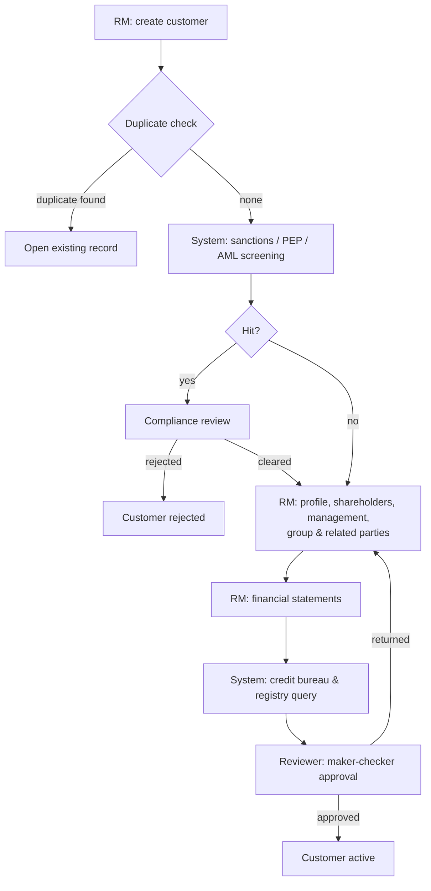

| Step | Actor | Activity | Input | Output | Rules / controls | Exceptions |
| --- | --- | --- | --- | --- | --- | --- |
| 1 | RM | Create customer | ID documents, registration certificate | Draft customer | BR-CUS-001 unique key = ID type + ID number | Duplicate → reuse existing customer |
| 2 | System | Screen sanctions, PEP and AML lists | Name, ID, nationality, shareholders | Screening result | BR-CUS-002 any hit blocks the process | Screening service down → hold, retry |
| 3 | Compliance | Review hits | Screening result | Cleared / rejected | Decision and reason recorded | Rejection ends the process |
| 4 | RM | Maintain profile, group and related parties | Shareholder structure | Group links | BR-CUS-003 control ≥ 50% or de facto control → same group | Unclear control → risk decides |
| 5 | RM | Enter or import financial statements | Audited / management accounts | Financial statement | BR-CUS-004 balance sheet must balance | Unaudited → flag |
| 6 | System | Query credit bureau and registries | Customer consent | External report | Consent must be on file | No record → note "thin file" |
| 7 | Reviewer | Approve record | Complete customer | Active customer | Maker ≠ checker | Returned → back to step 4 |

---

### 3.3 P-02 Corporate credit application and approval

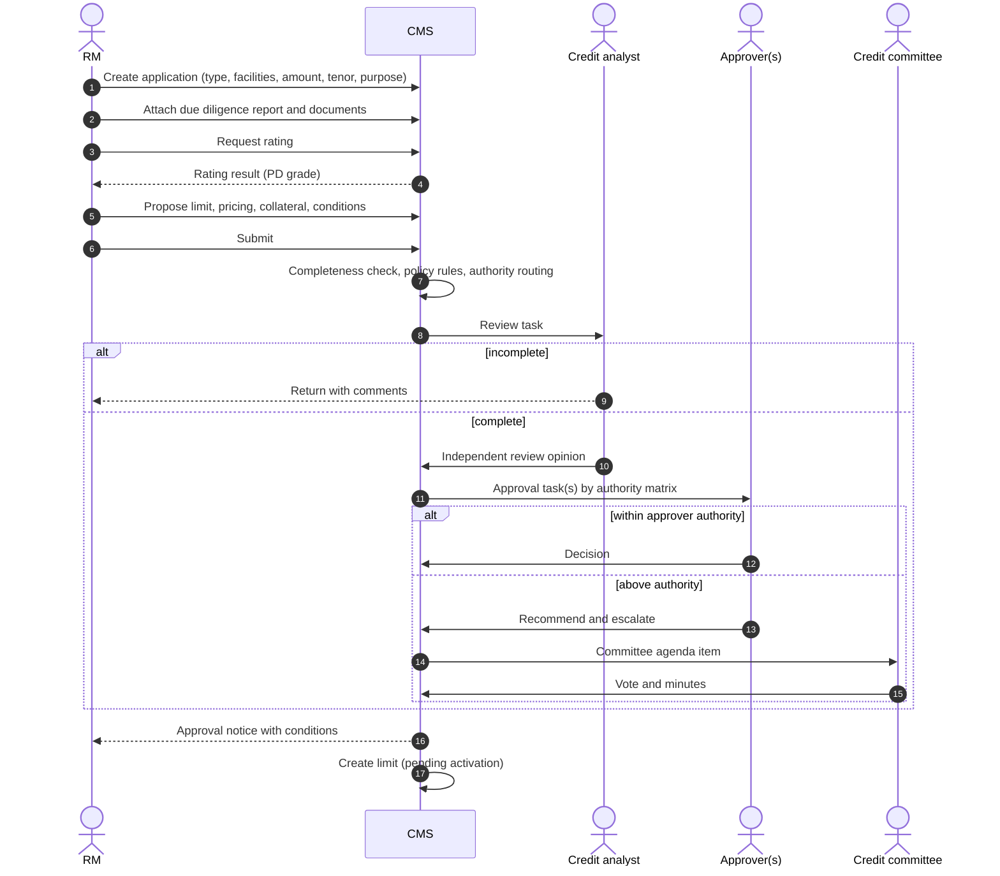

**Step detail**

| Step | Actor | Activity | Rules / controls |
| --- | --- | --- | --- |
| 1 | RM | Create application, choosing type: new, renewal, increase, change, one-off | BR-APP-001 one open application per customer per facility type |
| 2 | RM | Add facility requests: product, amount, currency, tenor, repayment, purpose | Product eligibility rules (C-02) |
| 3 | RM | Complete due diligence report from template | Mandatory sections by customer segment |
| 4 | RM / System | Rating: model computes score; RM may propose override | BR-RAT-002 override needs reason and risk approval |
| 5 | RM | Propose collateral and guarantees from collateral pool or new entries | Collateral must exist in C-07 before approval |
| 6 | RM | Propose pricing | BR-PRC-001 price below grid floor = pricing exception, raises approval level |
| 7 | RM | Submit | All mandatory fields and documents present |
| 8 | System | Run policy rules: industry caps, related-party, large-exposure, blacklist | Rule hits shown to all approvers |
| 9 | System | Determine approval route from authority matrix | BR-AUT-001 (see 7) |
| 10 | Analyst | Independent review; write opinion | Analyst cannot edit the proposal |
| 11 | Approvers | Sequential or parallel approval | BR-APP-005 each approver acts once; no self-approval |
| 12 | Committee | Vote; secretary records minutes | Quorum and majority rules configurable |
| 13 | System | Issue decision; create pending limit | BR-APP-007 approval valid 180 days unless activated |

**Decision outcomes:** approve; approve with conditions; approve with amended terms; reject; return for more information. A rejected customer may apply again after a cooling-off period (configurable).

**Approval conditions** are of three types, each tracked to closure:
- **Pre-contract**: must be met before contract signing.
- **Pre-disbursement**: must be met before each or the first drawdown.
- **Post-disbursement**: covenants and follow-up items, monitored in P-11.

---

### 3.4 P-03 Retail credit application (automated decision)

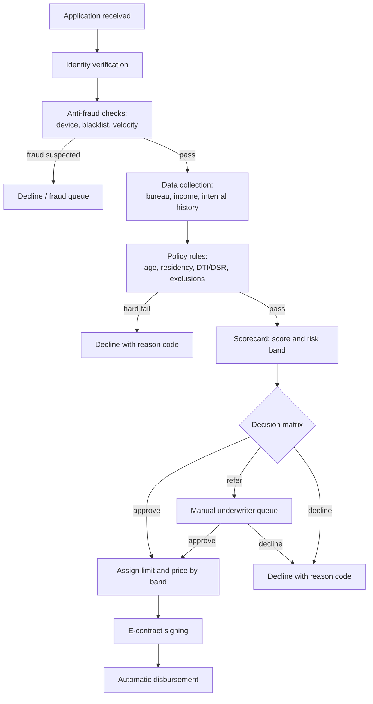

**Decision matrix example**

| Score band | Policy result: clean | Policy result: soft warning |
| --- | --- | --- |
| A (lowest risk) | Approve | Approve |
| B | Approve | Refer |
| C | Refer | Refer |
| D | Decline | Decline |

Rules: BR-RET-001 DTI (total monthly debt ÷ monthly income) must not exceed the product maximum. BR-RET-002 decline reasons must be recorded as standard codes for customer notification and model monitoring.

---

### 3.5 P-04 Rating and re-rating

| Step | Activity | Rule |
| --- | --- | --- |
| 1 | Select model by segment (large corporate, SME, real estate developer, financial institution, retail) | Model version effective on the rating date |
| 2 | Quantitative factors from financial statements (leverage, coverage, liquidity, profitability) | Statements no older than 18 months |
| 3 | Qualitative factors entered by RM (management, market position, industry outlook) | Each answer from a fixed list |
| 4 | Model computes score → grade → PD | Grade scale fixed per model |
| 5 | Adjustments: group support, country ceiling, warning signals | Rules-based, logged |
| 6 | Override (optional) | BR-RAT-002 up to 2 notches with risk approval; more needs CRO |
| 7 | Approval by risk analyst | Maker ≠ checker |
| 8 | Rating becomes effective | Re-rating at least yearly; trigger events force re-rating |

---

### 3.6 P-05 Limit management

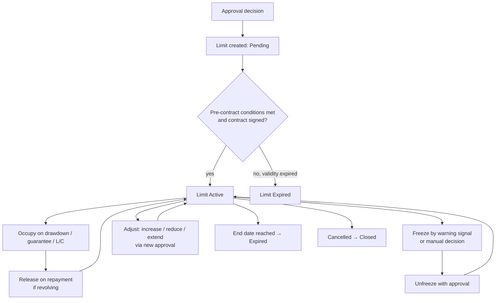

**Occupation check (BR-LIM-003)** runs for every drawdown or off-balance issuance:

1. Convert the amount into the limit currency at the current rate.
2. Walk up the limit tree (sub-limit → facility → customer → group). At every level, `available_amount ≥ requested_amount`.
3. No level is frozen, expired or outside its validity dates.
4. Product is in the limit's product scope.
5. Industry, country and single-borrower concentration caps are not exceeded.
6. Occupy all levels in one transaction; if any check fails, nothing is occupied.

**Occupation weight:** off-balance-sheet items can occupy at a credit conversion factor (for example, a performance guarantee at 50%), configurable per product.

---

### 3.7 P-06 Collateral management

| Step | Actor | Activity | Rules |
| --- | --- | --- | --- |
| 1 | RM / Credit Admin | Register collateral and owner | Owner must be a customer record (third-party owners included) |
| 2 | Valuer | Appraise: market value, valuation date, method | BR-COL-001 external valuer from approved panel above threshold |
| 3 | System | Apply haircut by collateral type → eligible value | Haircut table versioned |
| 4 | Credit Admin | Link to limit or contract with allocated value and lien rank | BR-COL-003 sum of allocations ≤ eligible value |
| 5 | Credit Admin / Legal | Perfect: register mortgage or pledge; store originals; insurance with bank as loss payee | Registration status must be "registered" before disbursement unless waived |
| 6 | System | Monitor: revaluation due, insurance expiry, registration expiry, LTV breach | BR-COL-005 revaluation frequency by type |
| 7 | Credit Admin | Release after secured exposure is repaid | Approval required; registration cancelled |

**Revaluation frequency (example)**

| Collateral type | Haircut | Revaluation |
| --- | --- | --- |
| Cash deposit (same currency) | 0% | Daily balance check |
| Government bonds | 2–5% | Daily mark-to-market |
| Listed shares | 30–50% | Daily mark-to-market |
| Residential real estate | 20–30% | Yearly, or index-based |
| Commercial real estate | 30–40% | Yearly |
| Receivables | 30–50% | Monthly |
| Machinery and equipment | 40–60% | Yearly |

---

### 3.8 P-07 Contract signing

| Step | Actor | Activity | Rules |
| --- | --- | --- | --- |
| 1 | Credit Admin | Generate contract from template; system fills terms from the approval | BR-CON-001 contract amount, tenor, price and collateral must match the approval |
| 2 | Legal | Review only if clauses deviate from the template | Deviations highlighted |
| 3 | Credit Admin | Generate security contracts (mortgage, pledge) and guarantee contracts | One per collateral or guarantor |
| 4 | Customer and bank | Sign, on paper or by e-signature | Signatory authority checked against customer records |
| 5 | Credit Admin | Record signing; contract becomes effective | Pre-contract conditions closed |
| 6 | System | Activate limit if all activation conditions are met | E-LIMIT-ACTIVATED |

---

### 3.9 P-08 Disbursement

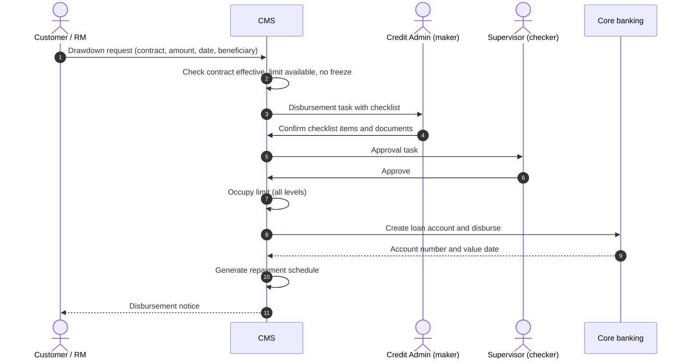

**Pre-disbursement checklist (configurable per product)**

- [ ] Contract and security contracts signed and effective
- [ ] Collateral registered (or waiver approved)
- [ ] Insurance in force with bank as loss payee
- [ ] All pre-disbursement approval conditions closed
- [ ] Use of funds evidence (invoice, purchase contract) for entrusted payment
- [ ] Customer not on the watch list with a disbursement block
- [ ] KYC still valid

Rules: BR-DIS-001 maker ≠ checker. BR-DIS-002 entrusted payment is required above a product-specific amount: funds go directly to the supplier. BR-DIS-003 if core banking posting fails, the limit occupation is reversed.

---

### 3.10 P-09 Repayment and loan servicing

**Daily batch (end of day)**

| Order | Job | Description |
| --- | --- | --- |
| 1 | Rate reset | Apply new base rate for floating loans on reset dates |
| 2 | Interest accrual | Daily interest on outstanding principal (day count per product, e.g. ACT/365) |
| 3 | Auto-debit | Collect installments due from the repayment account |
| 4 | Overdue marking | Unpaid installments become overdue; DPD increments |
| 5 | Penalty interest | Penalty rate on overdue principal and interest |
| 6 | Limit release | Release repaid principal on revolving limits |
| 7 | Event publish | E-LOAN-REPAID, E-LOAN-OVERDUE |
| 8 | Reconciliation | Compare balances with core banking; raise breaks |

**Repayment allocation order (BR-SRV-001, configurable):** fees → penalty interest → overdue interest → overdue principal → current interest → current principal.

**Repayment methods:** equal installments (annuity), equal principal, interest-only with bullet, balloon, custom schedule.

---

### 3.11 P-10 Loan changes

| Change type | Needs approval | Treated as restructuring if borrower is in difficulty |
| --- | --- | --- |
| Extension of maturity | Yes | Yes |
| Rescheduling (installment amounts or dates) | Yes | Yes |
| Rate change | Yes (pricing authority) | If rate is below market |
| Repayment account change | No (maker-checker only) | No |
| Prepayment | No, unless fee waiver | No |
| Collateral substitution | Yes | No |
| Guarantor change | Yes | No |

BR-CHG-001 a change that eases terms for a borrower with DPD > 0 or a "Special mention" or worse classification is flagged as restructuring (P-14).

---

### 3.12 P-11 Monitoring and early warning

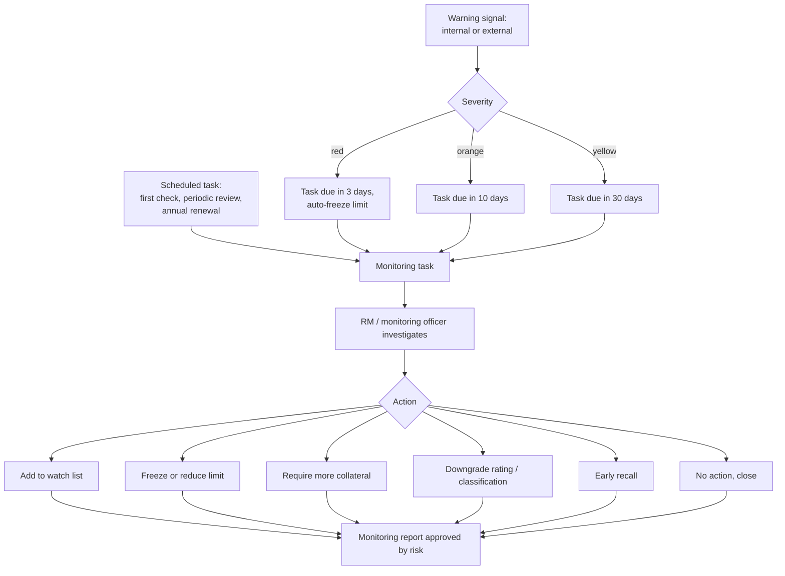

**Warning signal catalog (examples)**

| Code | Signal | Source | Default severity |
| --- | --- | --- | --- |
| EW-01 | Any installment overdue > 7 days | Loan | Yellow |
| EW-02 | Overdue > 30 days | Loan | Orange |
| EW-03 | Account inflows down > 50% vs 3-month average | Core banking | Orange |
| EW-04 | Rating downgrade by ≥ 2 notches | Rating | Orange |
| EW-05 | New lawsuit as defendant above threshold | Court records | Red |
| EW-06 | Default at another bank | Credit bureau | Red |
| EW-07 | Covenant breach | Covenant test | Orange |
| EW-08 | Collateral LTV above maximum | Collateral | Orange |
| EW-09 | Key person change (CEO, major shareholder) | Registry | Yellow |
| EW-10 | Negative news (fraud, bankruptcy, sanctions) | News | Red |

**Scheduled monitoring frequency**

| Classification / risk | Periodic review |
| --- | --- |
| Normal, low risk | Every 12 months |
| Normal, medium risk | Every 6 months |
| Special mention / watch list | Every 3 months |
| Non-performing | Monthly (case review) |

---

### 3.13 P-12 Risk classification and provisioning

| Step | Actor | Activity |
| --- | --- | --- |
| 1 | System | Month-end batch proposes classification per loan from DPD, restructuring flag, rating and signals |
| 2 | System | Customer-level alignment: all loans of a customer take the worst class (BR-CLS-002, configurable) |
| 3 | RM | Propose adjustments with reasons |
| 4 | Risk | Approve adjustments; upgrades need stricter approval than downgrades |
| 5 | System | Determine IFRS 9 stage and compute ECL = PD × LGD × EAD (scenario-weighted) |
| 6 | Risk | Individual impairment assessment for large Stage 3 exposures (discounted recovery cash flows) |
| 7 | Finance | Approve provisions; post to GL |
| 8 | System | Lock the period; publish E-CLASS-CHANGED and E-ECL-POSTED |

**Classification mapping (example; local rules apply)**

| DPD / condition | Five-category | IFRS 9 stage |
| --- | --- | --- |
| 0, no weakness | Normal | Stage 1 |
| 1–30, or weakness identified | Normal / Special mention | Stage 1 or 2 |
| 31–90, or significant increase in credit risk | Special mention | Stage 2 |
| 91–180 | Substandard | Stage 3 |
| 181–360 | Doubtful | Stage 3 |
| > 360, or recovery unlikely | Loss | Stage 3 |
| Restructured, in probation | At least Substandard (configurable) | Stage 2 or 3 |

---

### 3.14 P-13 Collection

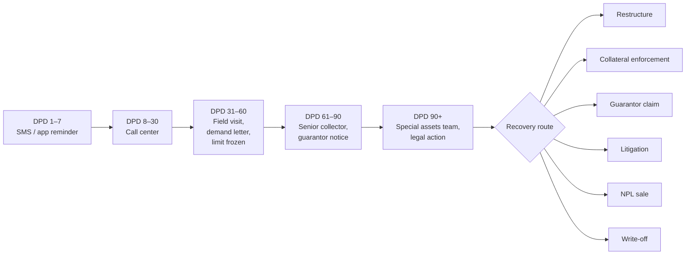

| Item | Design |
| --- | --- |
| Case creation | Automatic at DPD 1; one case per customer, covering all overdue loans |
| Strategy | Assigned by segment × DPD bucket × risk score; configurable |
| Actions | Call, SMS, letter, visit, legal notice; each logged with outcome |
| Payment promise | Date and amount; broken promise escalates the case |
| Agency assignment | Late-stage cases may go to external agencies; commission tracked |
| Closure | Overdue fully cleared, restructured, sold or written off |

---

### 3.15 P-14 Restructuring, NPL and write-off

| Route | Key steps | Approval |
| --- | --- | --- |
| Restructuring | Viability analysis → new terms → approval → amendment contract → restructured flag → probation (e.g. 12 months) | Per authority matrix, one level above normal |
| Collateral enforcement | Legal notice → auction or private sale → proceeds allocated to the loan | Special assets head |
| Litigation | Case filed → hearings → judgment → enforcement → recovery | Legal head |
| NPL sale | Portfolio selection → valuation → bidding → sale agreement → derecognition | Board or delegated committee |
| Write-off | Evidence that recovery is unlikely → provision 100% → approval → off-balance tracking → continued recovery | High level (CRO / board), per local rules |

BR-WOF-001 written-off accounts stay in the CMS off-balance-sheet with continued collection and recovery tracking.

---

### 3.16 P-15 Closure and collateral release

| Step | Activity | Rule |
| --- | --- | --- |
| 1 | Final repayment received; loan balance = 0 | All fees and interest settled |
| 2 | Loan closed; limit released or closed | Non-revolving limit closes |
| 3 | Check whether collateral secures other exposures | BR-COL-007 release only if no other secured exposure |
| 4 | Release approval | Maker-checker |
| 5 | Cancel registration; return original documents | Customer receipt recorded |
| 6 | Archive the credit file | Retention period per policy (e.g. 10 years) |

---

## 4. Business data model

### 4.1 Subject areas

| Code | Subject area | Core entities |
| --- | --- | --- |
| PTY | Party | CUSTOMER, INDIVIDUAL, ORGANIZATION, CUSTOMER_GROUP, GROUP_MEMBER, RELATED_PARTY, FINANCIAL_STATEMENT, FIN_STMT_ITEM, EXTERNAL_REPORT |
| PRD | Product | PRODUCT, PRODUCT_PARAM, RATE_SCHEME, FEE_SCHEME |
| APP | Application & approval | CREDIT_APPLICATION, FACILITY_REQUEST, APPROVAL_TASK, APPROVAL_OPINION, COMMITTEE_MEETING, COMMITTEE_VOTE, APPROVAL_DECISION, APPROVAL_CONDITION |
| RAT | Rating | RATING_MODEL, RATING_RECORD, RATING_FACTOR_SCORE |
| AUT | Authority | AUTHORITY_RULE, AUTHORITY_DELEGATION |
| LIM | Limit | CREDIT_LIMIT, LIMIT_TXN, LIMIT_FREEZE |
| COL | Collateral | COLLATERAL, COLLATERAL_VALUATION, COLLATERAL_LINK, COLLATERAL_REGISTRATION, INSURANCE_POLICY, GUARANTEE |
| CON | Contract | LOAN_CONTRACT, SECURITY_CONTRACT, CONTRACT_AMENDMENT |
| LON | Loan | LOAN, REPAYMENT_SCHEDULE, LOAN_TXN, INTEREST_ACCRUAL, RATE_HISTORY |
| MON | Monitoring | MONITORING_TASK, MONITORING_REPORT, WARNING_SIGNAL, WATCH_LIST, COVENANT, COVENANT_TEST |
| AQ | Asset quality | RISK_CLASSIFICATION, ECL_RESULT |
| CLC | Collection | DELINQUENCY_CASE, COLLECTION_ACTION, PAYMENT_PROMISE, LITIGATION_CASE, RECOVERY, WRITE_OFF |
| ORG | Organization & control | ORG_UNIT, APP_USER, ROLE, USER_ROLE, DOCUMENT, AUDIT_LOG |

### 4.2 Overall entity relationships

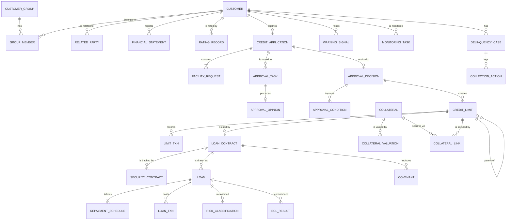

### 4.3 Party

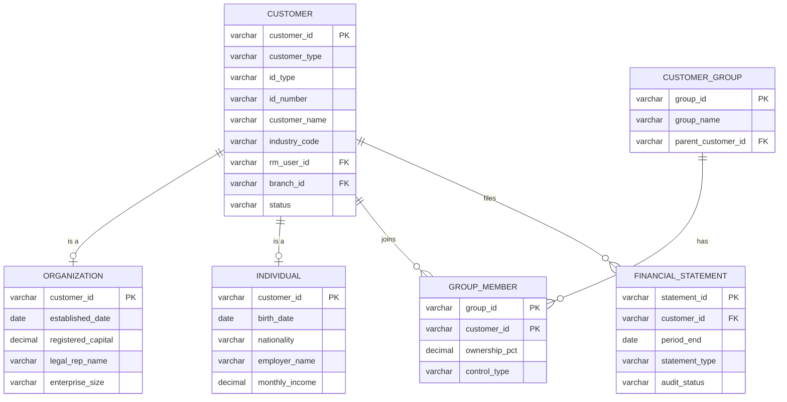

**CUSTOMER**

| Field | Type | Req | Description |
| --- | --- | --- | --- |
| customer_id | varchar(20) | Y | Bank-wide customer number (CIF), primary key |
| customer_type | varchar(10) | Y | IND (individual), ORG (organization), FI (financial institution) |
| id_type | varchar(10) | Y | Passport, national ID, corporate registration number, etc. |
| id_number | varchar(40) | Y | Unique together with id_type (BR-CUS-001) |
| customer_name | varchar(200) | Y | Legal name |
| customer_name_local | varchar(200) | N | Name in local script (e.g. kanji) |
| industry_code | varchar(10) | C | Required for ORG; national industry classification |
| country_code | char(2) | Y | ISO 3166 |
| region_code | varchar(10) | N | For concentration reporting |
| segment | varchar(10) | Y | LARGE, SME, MICRO, RETAIL, FI |
| rm_user_id | varchar(20) | Y | Responsible RM; drives data scope |
| branch_id | varchar(10) | Y | Owning branch |
| kyc_status | varchar(10) | Y | PENDING, CLEARED, EXPIRED, REJECTED |
| kyc_expiry_date | date | N | Next KYC refresh date |
| aml_risk_level | varchar(10) | Y | LOW, MEDIUM, HIGH |
| current_rating_grade | varchar(5) | N | Snapshot of latest effective rating |
| current_rating_date | date | N | |
| is_related_party | boolean | Y | Related to the bank (insiders, shareholders) |
| status | varchar(10) | Y | PROSPECT, ACTIVE, FROZEN, CLOSED |
| created_at / created_by | timestamp / varchar | Y | Audit columns, on every table |
| updated_at / updated_by | timestamp / varchar | Y | |
| version_no | integer | Y | Optimistic locking, on every table |

**GROUP_MEMBER**

| Field | Type | Req | Description |
| --- | --- | --- | --- |
| group_id | varchar(20) | Y | PK part |
| customer_id | varchar(20) | Y | PK part |
| ownership_pct | decimal(5,2) | N | Direct or indirect ownership |
| control_type | varchar(20) | Y | EQUITY, DE_FACTO, GUARANTEE_CHAIN, COMMON_MANAGEMENT |
| effective_from / effective_to | date | Y / N | Membership history |

**FINANCIAL_STATEMENT** and **FIN_STMT_ITEM**

| Field | Type | Req | Description |
| --- | --- | --- | --- |
| statement_id | varchar(20) | Y | PK |
| customer_id | varchar(20) | Y | FK |
| period_end | date | Y | Reporting date |
| period_type | varchar(5) | Y | FY, H1, Q1–Q4 |
| statement_type | varchar(10) | Y | CONSOLIDATED, STANDALONE |
| audit_status | varchar(10) | Y | AUDITED, REVIEWED, MANAGEMENT |
| currency | char(3) | Y | ISO 4217 |
| item_code (item table) | varchar(20) | Y | Standard chart (total assets, revenue, EBITDA…) |
| item_value (item table) | decimal(20,2) | Y | |

### 4.4 Application and approval

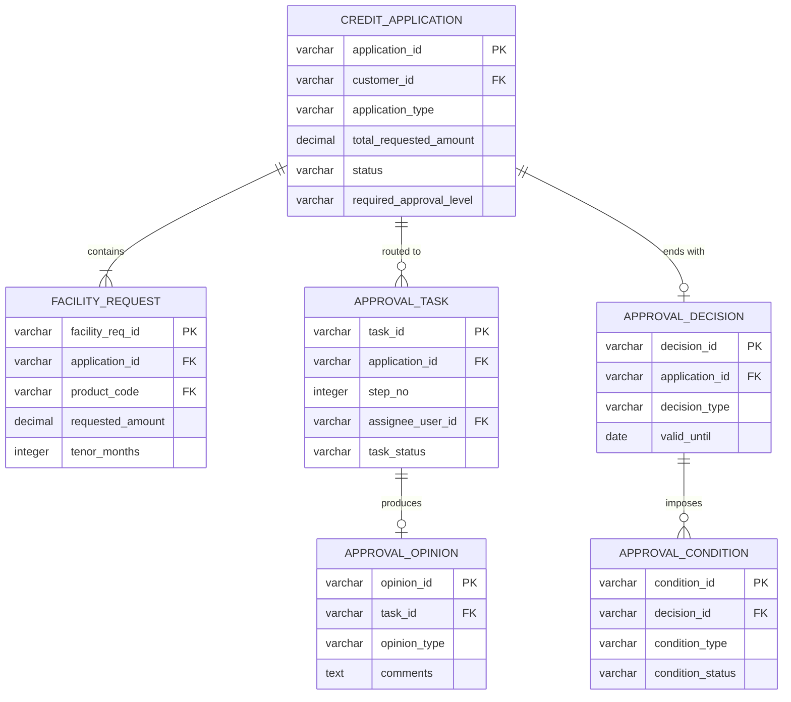

**CREDIT_APPLICATION**

| Field | Type | Req | Description |
| --- | --- | --- | --- |
| application_id | varchar(20) | Y | PK |
| customer_id | varchar(20) | Y | FK → CUSTOMER |
| application_type | varchar(10) | Y | NEW, RENEWAL, INCREASE, CHANGE, ONEOFF |
| channel | varchar(10) | Y | BRANCH, RM, ONLINE, API |
| total_requested_amount | decimal(20,2) | Y | Sum of facility requests in reporting currency |
| reporting_currency | char(3) | Y | |
| purpose | varchar(500) | Y | |
| repayment_source | varchar(500) | Y | |
| rating_record_id | varchar(20) | C | Required before submit for ORG customers |
| proposed_pricing_summary | varchar(500) | N | |
| policy_exceptions | varchar(500) | N | Rule hits from BR checks |
| required_approval_level | varchar(10) | C | Set by authority routing at submit |
| status | varchar(15) | Y | See state machine 5.1 |
| submitted_by / submitted_at | varchar / timestamp | C | Set on submit |
| decision_id | varchar(20) | N | FK → APPROVAL_DECISION |

**FACILITY_REQUEST**

| Field | Type | Req | Description |
| --- | --- | --- | --- |
| facility_req_id | varchar(20) | Y | PK |
| application_id | varchar(20) | Y | FK |
| product_code | varchar(10) | Y | FK → PRODUCT |
| requested_amount | decimal(20,2) | Y | |
| currency | char(3) | Y | |
| tenor_months | integer | Y | |
| revolving_flag | boolean | Y | |
| rate_type | varchar(10) | Y | FIXED, FLOATING |
| base_rate_code | varchar(10) | C | Required if FLOATING |
| margin_bps | integer | Y | Spread in basis points |
| repayment_method | varchar(10) | Y | ANNUITY, EQUAL_PRIN, BULLET, BALLOON, CUSTOM |
| proposed_collateral_ids | array | N | References to COLLATERAL |
| approved_amount | decimal(20,2) | N | Filled by decision |

**APPROVAL_TASK / APPROVAL_OPINION**

| Field | Type | Req | Description |
| --- | --- | --- | --- |
| task_id | varchar(20) | Y | PK |
| application_id | varchar(20) | Y | FK |
| step_no | integer | Y | Order in the route |
| step_type | varchar(10) | Y | REVIEW, APPROVE, COMMITTEE |
| assignee_user_id | varchar(20) | Y | |
| assignee_role | varchar(20) | Y | |
| authority_level | varchar(10) | Y | |
| delegated_from | varchar(20) | N | If acting under delegation |
| task_status | varchar(10) | Y | OPEN, CLAIMED, DONE, RETURNED, CANCELLED |
| due_at | timestamp | Y | SLA |
| opinion_type (opinion) | varchar(15) | Y | AGREE, AGREE_COND, DISAGREE, RETURN, ESCALATE |
| comments (opinion) | text | Y | |
| conditions_proposed (opinion) | text | N | |
| acted_at (opinion) | timestamp | Y | |

**APPROVAL_DECISION / APPROVAL_CONDITION**

| Field | Type | Req | Description |
| --- | --- | --- | --- |
| decision_id | varchar(20) | Y | PK |
| application_id | varchar(20) | Y | FK |
| decision_type | varchar(15) | Y | APPROVED, APPROVED_COND, AMENDED, REJECTED |
| decided_by | varchar(20) | Y | Final approver or committee ID |
| decided_at | timestamp | Y | |
| valid_until | date | C | Required if approved (BR-APP-007) |
| condition_type (condition) | varchar(10) | Y | PRE_CONTRACT, PRE_DISB, POST_DISB |
| condition_text (condition) | varchar(1000) | Y | |
| due_date (condition) | date | C | Required for POST_DISB |
| condition_status (condition) | varchar(10) | Y | OPEN, MET, WAIVED, BREACHED |
| evidence_doc_id (condition) | varchar(20) | N | FK → DOCUMENT |

### 4.5 Rating

| Entity | Field | Type | Req | Description |
| --- | --- | --- | --- | --- |
| RATING_MODEL | model_id, model_version | varchar | Y | PK; versioned |
| | segment | varchar(10) | Y | Segment the model applies to |
| | effective_from / effective_to | date | Y / N | |
| RATING_RECORD | rating_id | varchar(20) | Y | PK |
| | customer_id | varchar(20) | Y | FK |
| | model_id, model_version | varchar | Y | Model used |
| | rating_date | date | Y | |
| | financial_statement_id | varchar(20) | C | Required for ORG |
| | model_score | decimal(8,4) | Y | |
| | model_grade | varchar(5) | Y | Grade before override |
| | override_grade | varchar(5) | N | |
| | override_reason | varchar(500) | C | Required if override |
| | final_grade | varchar(5) | Y | |
| | pd | decimal(9,6) | Y | Probability of default for the grade |
| | status | varchar(10) | Y | DRAFT, APPROVED, SUPERSEDED |
| | approved_by / approved_at | varchar / timestamp | C | |
| RATING_FACTOR_SCORE | rating_id, factor_code | varchar | Y | PK |
| | factor_value, factor_score | decimal | Y | Input and score per factor |

### 4.6 Limit

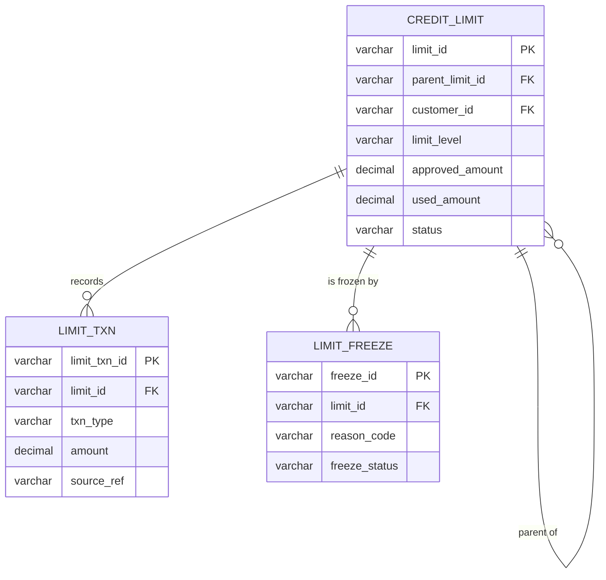

**CREDIT_LIMIT**

| Field | Type | Req | Description |
| --- | --- | --- | --- |
| limit_id | varchar(20) | Y | PK |
| parent_limit_id | varchar(20) | N | Null for the top node |
| limit_level | varchar(10) | Y | GROUP, CUSTOMER, FACILITY, SUBLIMIT |
| group_id | varchar(20) | C | Required for GROUP level |
| customer_id | varchar(20) | C | Required below GROUP |
| product_scope | array | C | Products allowed (FACILITY, SUBLIMIT) |
| currency | char(3) | Y | Limit currency |
| approved_amount | decimal(20,2) | Y | |
| used_amount | decimal(20,2) | Y | Derived from LIMIT_TXN; reconciled daily |
| available_amount | decimal(20,2) | Y | approved − used (never negative except approved overdraw) |
| revolving_flag | boolean | Y | |
| start_date / end_date | date | Y | |
| last_drawdown_date | date | N | No new occupation after this date |
| source_decision_id | varchar(20) | Y | FK → APPROVAL_DECISION |
| status | varchar(10) | Y | See state machine 5.2 |

**LIMIT_TXN** (append-only)

| Field | Type | Req | Description |
| --- | --- | --- | --- |
| limit_txn_id | varchar(30) | Y | PK |
| limit_id | varchar(20) | Y | FK |
| txn_type | varchar(10) | Y | OCCUPY, RELEASE, REVERSE, ADJUST |
| amount | decimal(20,2) | Y | In limit currency |
| original_amount / original_currency | decimal / char(3) | Y | Before conversion |
| fx_rate | decimal(18,8) | Y | Rate used |
| ccf | decimal(5,4) | Y | Credit conversion factor (1.0 for loans) |
| source_type | varchar(10) | Y | LOAN, GUARANTEE, LC, BILL, MANUAL |
| source_ref | varchar(30) | Y | ID of the source object |
| business_date | date | Y | |
| reversal_of | varchar(30) | N | Links a REVERSE to the original |

### 4.7 Collateral

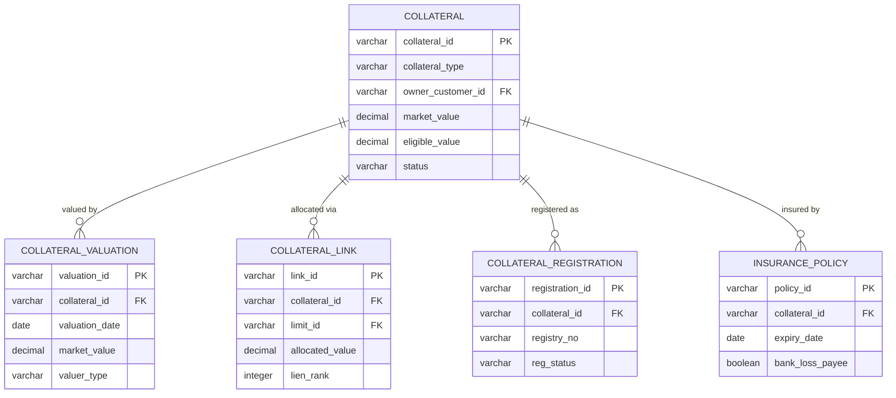

**COLLATERAL**

| Field | Type | Req | Description |
| --- | --- | --- | --- |
| collateral_id | varchar(20) | Y | PK |
| collateral_type | varchar(10) | Y | RE_RES, RE_COM, LAND, DEPOSIT, BOND, SHARE, RECEIV, EQUIP, VEHICLE, OTHER |
| collateral_class | varchar(10) | Y | MORTGAGE, PLEDGE, LIEN |
| owner_customer_id | varchar(20) | Y | Owner, may be a third party |
| description | varchar(1000) | Y | |
| location / address | varchar(500) | C | Required for real estate |
| registry_reference | varchar(50) | C | Land registry, securities account, etc. |
| currency | char(3) | Y | |
| market_value | decimal(20,2) | Y | Snapshot of latest valuation |
| valuation_date | date | Y | |
| haircut_pct | decimal(5,2) | Y | From haircut table at valuation date |
| eligible_value | decimal(20,2) | Y | market_value × (1 − haircut) |
| allocated_total | decimal(20,2) | Y | Sum of active links (BR-COL-003) |
| next_revaluation_date | date | Y | BR-COL-005 |
| status | varchar(10) | Y | DRAFT, REGISTERED, PLEDGED, RELEASED, ENFORCED |

**COLLATERAL_LINK**

| Field | Type | Req | Description |
| --- | --- | --- | --- |
| link_id | varchar(20) | Y | PK |
| collateral_id | varchar(20) | Y | FK |
| limit_id | varchar(20) | C | Link at limit level, or |
| contract_id | varchar(20) | C | link at contract level (one of the two) |
| allocated_value | decimal(20,2) | Y | |
| lien_rank | integer | Y | 1 = first lien |
| effective_from / effective_to | date | Y / N | |
| link_status | varchar(10) | Y | ACTIVE, RELEASED |

**GUARANTEE** (personal or corporate guarantee as a credit mitigant)

| Field | Type | Req | Description |
| --- | --- | --- | --- |
| guarantee_id | varchar(20) | Y | PK |
| guarantor_customer_id | varchar(20) | Y | FK → CUSTOMER |
| guarantee_type | varchar(10) | Y | JOINT_SEVERAL, LIMITED, GUAR_COMPANY |
| guaranteed_amount | decimal(20,2) | Y | |
| limit_id / contract_id | varchar(20) | C | What it secures |
| start_date / end_date | date | Y | |

### 4.8 Contract and loan

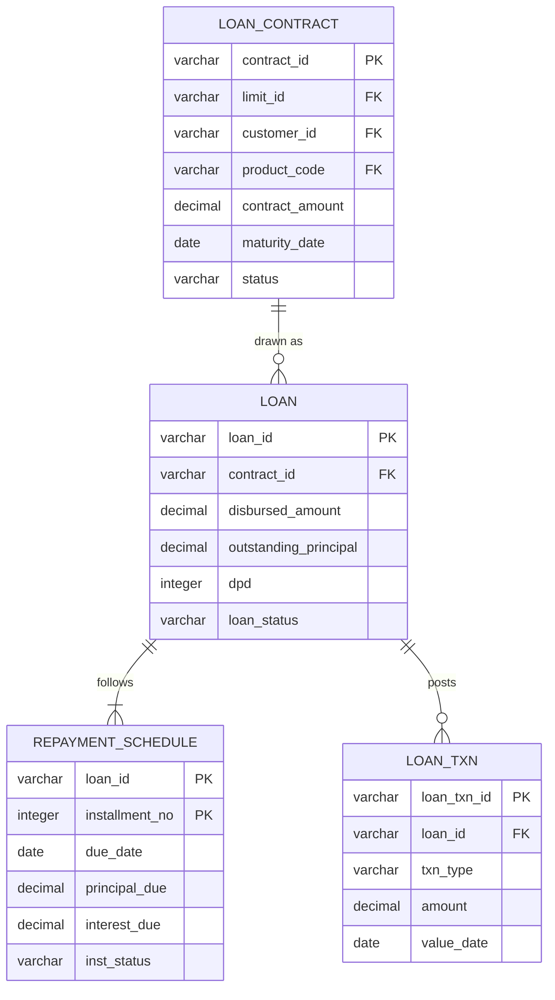

**LOAN_CONTRACT**

| Field | Type | Req | Description |
| --- | --- | --- | --- |
| contract_id | varchar(20) | Y | PK |
| contract_no | varchar(30) | Y | Printed contract number |
| customer_id | varchar(20) | Y | FK |
| limit_id | varchar(20) | Y | FK → CREDIT_LIMIT (facility level) |
| decision_id | varchar(20) | Y | FK → APPROVAL_DECISION |
| product_code | varchar(10) | Y | FK |
| contract_amount | decimal(20,2) | Y | ≤ approved facility amount (BR-CON-001) |
| currency | char(3) | Y | |
| rate_type / base_rate_code / margin_bps | varchar / varchar / integer | Y / C / Y | |
| repayment_method | varchar(10) | Y | |
| start_date / maturity_date | date | Y | |
| availability_end_date | date | Y | Last date to draw |
| template_id / template_version | varchar | Y | |
| has_deviation | boolean | Y | Non-standard clauses present |
| signed_date | date | C | |
| status | varchar(10) | Y | DRAFT, SIGNED, EFFECTIVE, TERMINATED, CLOSED |

**LOAN** (drawdown)

| Field | Type | Req | Description |
| --- | --- | --- | --- |
| loan_id | varchar(20) | Y | PK |
| contract_id | varchar(20) | Y | FK |
| core_account_no | varchar(30) | Y | Account in core banking |
| disbursed_amount | decimal(20,2) | Y | |
| disbursement_date | date | Y | |
| maturity_date | date | Y | |
| current_rate | decimal(9,6) | Y | All-in annual rate |
| outstanding_principal | decimal(20,2) | Y | |
| accrued_interest | decimal(20,2) | Y | |
| overdue_principal / overdue_interest | decimal(20,2) | Y | |
| penalty_interest | decimal(20,2) | Y | |
| dpd | integer | Y | Days past due of the oldest unpaid installment |
| next_due_date | date | N | |
| entrusted_payment_flag | boolean | Y | |
| restructured_flag | boolean | Y | |
| classification / ifrs9_stage | varchar(10) / smallint | Y | Snapshots of latest result |
| loan_status | varchar(10) | Y | See state machine 5.3 |

**REPAYMENT_SCHEDULE**

| Field | Type | Req | Description |
| --- | --- | --- | --- |
| loan_id + installment_no | varchar + integer | Y | PK |
| due_date | date | Y | |
| principal_due / interest_due / fee_due | decimal(20,2) | Y | |
| principal_paid / interest_paid / fee_paid | decimal(20,2) | Y | |
| inst_status | varchar(10) | Y | FUTURE, DUE, PAID, PARTIAL, OVERDUE |
| schedule_version | integer | Y | Incremented on reschedule; old versions kept |

**LOAN_TXN** (append-only)

| Field | Type | Req | Description |
| --- | --- | --- | --- |
| loan_txn_id | varchar(30) | Y | PK |
| loan_id | varchar(20) | Y | FK |
| txn_type | varchar(10) | Y | DISBURSE, REPAY, PREPAY, ACCRUE, PENALTY, FEE, WRITEOFF, RECOVER, REVERSE |
| amount | decimal(20,2) | Y | |
| principal_part / interest_part / penalty_part / fee_part | decimal(20,2) | Y | Allocation (BR-SRV-001) |
| value_date / business_date | date | Y | |
| core_txn_ref | varchar(40) | Y | Link to core banking posting |

### 4.9 Monitoring and asset quality

| Entity | Field | Type | Req | Description |
| --- | --- | --- | --- | --- |
| WARNING_SIGNAL | signal_id | varchar(20) | Y | PK |
| | signal_code | varchar(10) | Y | From signal catalog (EW-01…) |
| | customer_id / loan_id | varchar(20) | Y / N | |
| | source | varchar(10) | Y | INTERNAL, BUREAU, COURT, REGISTRY, NEWS, MANUAL |
| | severity | varchar(10) | Y | RED, ORANGE, YELLOW |
| | detected_at | timestamp | Y | |
| | assigned_to | varchar(20) | Y | |
| | due_at | timestamp | Y | By severity |
| | action_code | varchar(10) | N | NONE, WATCH, FREEZE, REDUCE, COLLATERAL, DOWNGRADE, RECALL |
| | signal_status | varchar(10) | Y | OPEN, IN_PROGRESS, CLOSED |
| MONITORING_TASK | task_id | varchar(20) | Y | PK |
| | task_type | varchar(10) | Y | FIRST_CHECK, PERIODIC, RENEWAL, SIGNAL |
| | customer_id | varchar(20) | Y | |
| | due_date | date | Y | |
| | report_id | varchar(20) | N | FK → MONITORING_REPORT when done |
| COVENANT | covenant_id | varchar(20) | Y | PK |
| | contract_id | varchar(20) | Y | FK |
| | covenant_type | varchar(10) | Y | FINANCIAL, INFORMATION, NEGATIVE |
| | metric_code / operator / threshold | varchar / varchar / decimal | C | e.g. DSCR ≥ 1.2 (financial covenants) |
| | test_frequency | varchar(10) | Y | QUARTERLY, SEMIANNUAL, ANNUAL |
| COVENANT_TEST | test_id, covenant_id, test_date | — | Y | |
| | actual_value, result | decimal / varchar | Y | PASS, BREACH, WAIVED |
| RISK_CLASSIFICATION | loan_id + as_of_date | varchar + date | Y | PK; one row per period |
| | system_class | varchar(10) | Y | NORMAL, SPECIAL, SUBSTD, DOUBTFUL, LOSS |
| | final_class | varchar(10) | Y | |
| | ifrs9_stage | smallint | Y | 1, 2, 3 |
| | adjust_reason | varchar(500) | C | Required if final ≠ system |
| | approved_by | varchar(20) | C | |
| ECL_RESULT | loan_id + as_of_date + scenario | — | Y | PK |
| | pd_12m / pd_lifetime | decimal(9,6) | Y | |
| | lgd | decimal(9,6) | Y | |
| | ead | decimal(20,2) | Y | |
| | ecl_amount | decimal(20,2) | Y | Scenario-weighted total on the weighted row |
| | method | varchar(10) | Y | COLLECTIVE, INDIVIDUAL |

### 4.10 Collection

| Entity | Field | Type | Req | Description |
| --- | --- | --- | --- | --- |
| DELINQUENCY_CASE | case_id | varchar(20) | Y | PK |
| | customer_id | varchar(20) | Y | One open case per customer |
| | opened_date | date | Y | |
| | dpd_bucket | varchar(10) | Y | B1 (1–30), B2 (31–60), B3 (61–90), B4 (90+) |
| | total_overdue | decimal(20,2) | Y | |
| | strategy_code | varchar(10) | Y | |
| | collector_id / agency_id | varchar(20) | Y / N | |
| | case_status | varchar(10) | Y | OPEN, PROMISED, LEGAL, RESTRUCT, RECOVERED, WRITTEN_OFF, CLOSED |
| COLLECTION_ACTION | action_id, case_id | varchar | Y | |
| | action_type | varchar(10) | Y | CALL, SMS, LETTER, VISIT, LEGAL_NOTICE |
| | outcome_code | varchar(10) | Y | CONTACTED, NO_ANSWER, PROMISE, REFUSED, DISPUTE |
| | action_at / action_by | timestamp / varchar | Y | |
| PAYMENT_PROMISE | promise_id, case_id | varchar | Y | |
| | promised_date / promised_amount | date / decimal | Y | |
| | promise_status | varchar(10) | Y | PENDING, KEPT, BROKEN |
| WRITE_OFF | writeoff_id, loan_id | varchar | Y | |
| | writeoff_amount / writeoff_date | decimal / date | Y | |
| | approval_ref | varchar(20) | Y | |
| | recovered_after | decimal(20,2) | Y | Running total of post-write-off recoveries |

### 4.11 Organization and control

| Entity | Purpose | Key fields |
| --- | --- | --- |
| ORG_UNIT | Branches and departments in a tree | org_id, parent_org_id, org_type, org_name |
| APP_USER | System users | user_id, org_id, employee_no, status |
| ROLE / USER_ROLE | Roles and assignment | role_id; user_id + role_id + data_scope (OWN, BRANCH, REGION, BANK) + valid dates |
| AUTHORITY_RULE | Authority matrix rows | rule_id, role_id, product_group, segment, max_amount, min_rating, collateral_condition, approval_level, version |
| AUTHORITY_DELEGATION | Temporary delegation | from_user, to_user, scope, valid_from, valid_to, approved_by |
| DOCUMENT | Files attached to any object | doc_id, owner_type, owner_id, doc_type, storage_ref, hash, uploaded_by |
| AUDIT_LOG | Immutable change log | log_id, object_type, object_id, action, before_json, after_json, user_id, ip, timestamp |

### 4.12 Code tables (reference data)

| Code table | Values (examples) |
| --- | --- |
| CUSTOMER_TYPE | IND, ORG, FI |
| SEGMENT | LARGE, SME, MICRO, RETAIL, FI |
| APPLICATION_TYPE | NEW, RENEWAL, INCREASE, CHANGE, ONEOFF |
| LIMIT_LEVEL | GROUP, CUSTOMER, FACILITY, SUBLIMIT |
| COLLATERAL_TYPE | RE_RES, RE_COM, LAND, DEPOSIT, BOND, SHARE, RECEIV, EQUIP, VEHICLE, OTHER |
| REPAYMENT_METHOD | ANNUITY, EQUAL_PRIN, BULLET, BALLOON, CUSTOM |
| CLASSIFICATION | NORMAL, SPECIAL, SUBSTD, DOUBTFUL, LOSS |
| DPD_BUCKET | B0 (current), B1 (1–30), B2 (31–60), B3 (61–90), B4 (90+) |
| SIGNAL_SEVERITY | RED, ORANGE, YELLOW |
| CONDITION_TYPE | PRE_CONTRACT, PRE_DISB, POST_DISB |

### 4.13 Data design rules

| # | Rule |
| --- | --- |
| DR-1 | Master entities keep a current snapshot; history lives in dated child tables (rating, valuation, classification, schedule versions) |
| DR-2 | Limit balances are derived from the append-only LIMIT_TXN ledger and reconciled daily; direct updates to used_amount are not allowed |
| DR-3 | Loan balances are mastered in core banking; the CMS copy is reconciled daily and breaks are raised as exceptions |
| DR-4 | Every amount has a currency; cross-currency aggregates store the FX rate and date used |
| DR-5 | Ratings, classifications and limits are bitemporal: effective date plus record timestamp, to answer "what did we know on date X" |
| DR-6 | Personal data (ID numbers, income, contact details) is encrypted at rest and masked by role |
| DR-7 | No physical delete of business records; status changes only, with audit log |
| DR-8 | Every table carries created/updated audit columns and a version number for optimistic locking |

---

## 5. State machines

### 5.1 Credit application

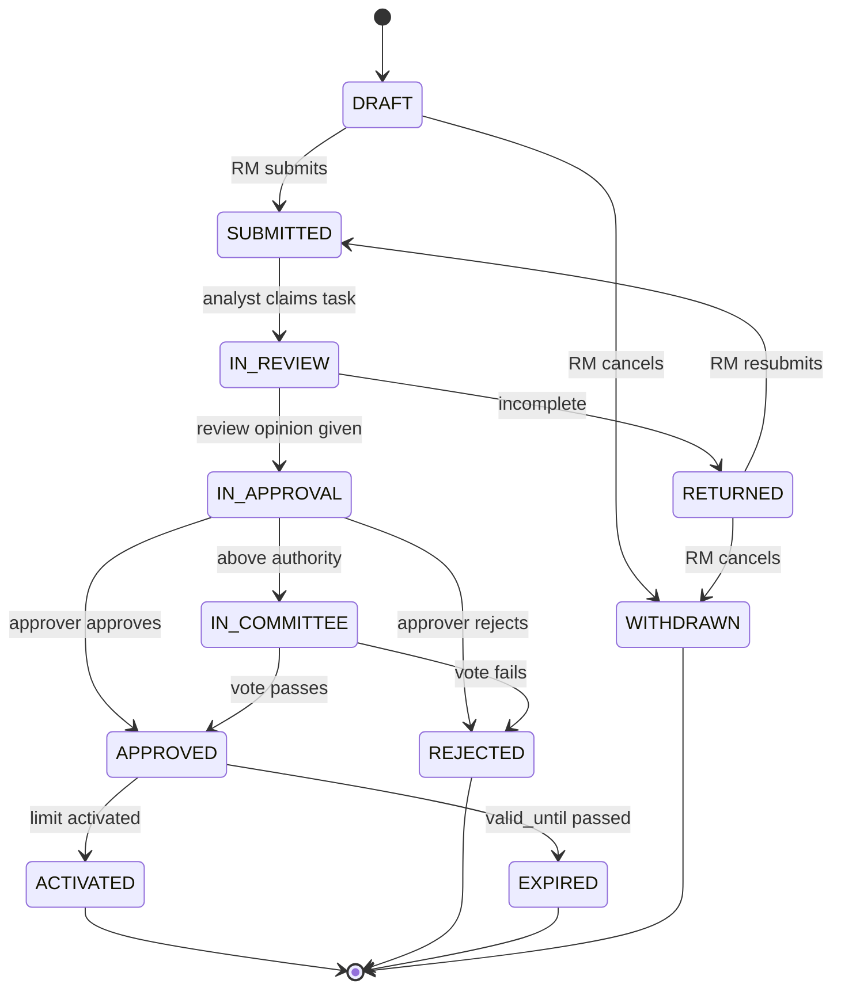

### 5.2 Credit limit

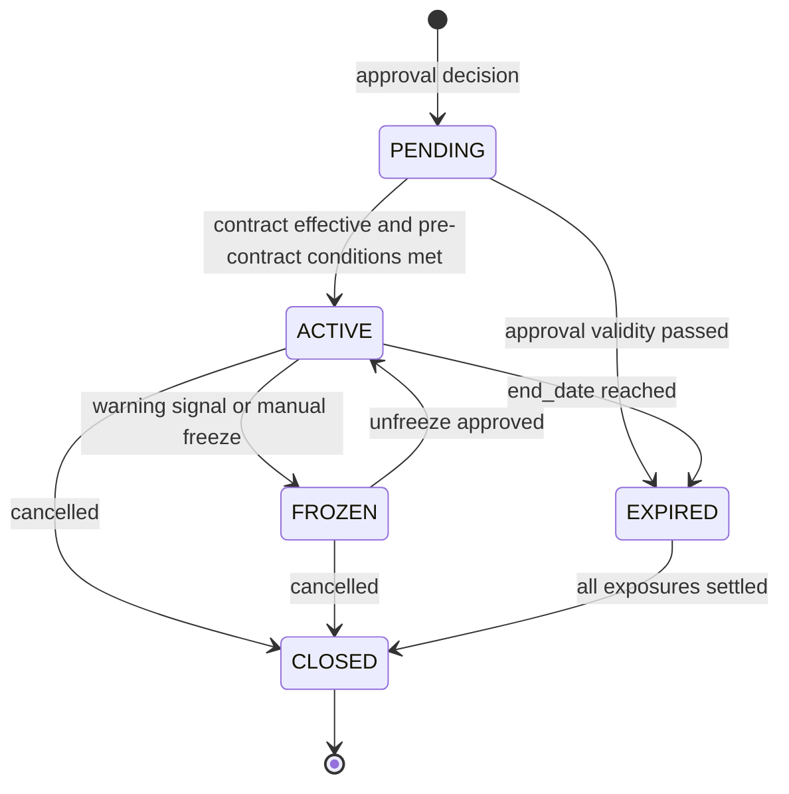

Allowed operations by status:

| Status | Occupy | Release | Adjust | Freeze |
| --- | --- | --- | --- | --- |
| PENDING | No | No | Yes | No |
| ACTIVE | Yes | Yes | Yes | Yes |
| FROZEN | No | Yes | Yes | — |
| EXPIRED | No | Yes | No | No |
| CLOSED | No | No | No | No |

### 5.3 Loan (drawdown)

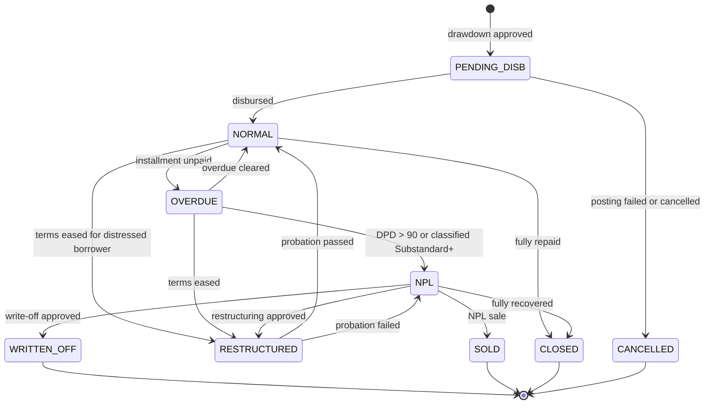

### 5.4 Collateral

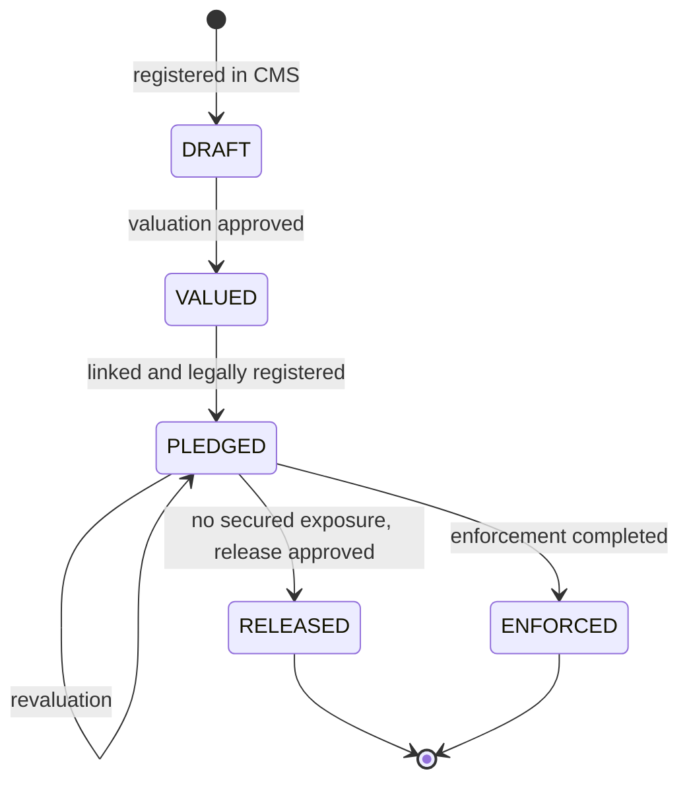

---

## 6. Business events

Events are published after the business transaction commits. Consumers include other CMS domains, the data warehouse, notification services and core banking adapters.

| Event | Published by | Payload (key fields) | Main consumers |
| --- | --- | --- | --- |
| E-CUSTOMER-ACTIVATED | Party | customer_id, segment, rm_user_id | Origination, DWH |
| E-RATING-APPROVED | Rating | customer_id, rating_id, final_grade, pd | Approval, Pricing, Asset quality |
| E-APP-SUBMITTED | Origination | application_id, customer_id, amount | Approval (routing), notifications |
| E-APP-DECIDED | Approval | application_id, decision_id, decision_type | Limit, notifications, DWH |
| E-LIMIT-ACTIVATED | Limit | limit_id, customer_id, amount | Contract, DWH |
| E-LIMIT-FROZEN | Limit | limit_id, reason_code | Disbursement, notifications |
| E-COLLATERAL-REVALUED | Collateral | collateral_id, eligible_value, ltv | Monitoring (LTV check), ECL |
| E-CONTRACT-EFFECTIVE | Contract | contract_id, limit_id | Limit activation, disbursement |
| E-LOAN-DISBURSED | Loan | loan_id, amount, value_date | Limit (occupy), GL, DWH, monitoring (first check) |
| E-LOAN-REPAID | Loan | loan_id, allocation | Limit (release), collection |
| E-LOAN-OVERDUE | Loan | loan_id, dpd, overdue_amount | Collection, monitoring (EW-01/02) |
| E-SIGNAL-RAISED | Monitoring | signal_id, severity, customer_id | RM tasks; Limit (auto-freeze on RED) |
| E-CLASS-CHANGED | Asset quality | loan_id, old_class, new_class, stage | GL, reporting, collection |
| E-ECL-POSTED | Asset quality | period, totals | GL, reporting |
| E-LOAN-WRITTEN-OFF | Collection | loan_id, amount | GL, limit (close), reporting |
| E-LOAN-CLOSED | Loan | loan_id | Limit, collateral release check |

---

## 7. Business rules catalog

| Rule ID | Area | Rule | Enforcement |
| --- | --- | --- | --- |
| BR-CUS-001 | Customer | ID type + ID number is unique across all customers | Hard block |
| BR-CUS-002 | Customer | A sanctions or PEP hit blocks onboarding until Compliance clears it | Hard block |
| BR-CUS-003 | Customer | Ownership ≥ 50% or de facto control places the customer in the same group | Proposed by system, confirmed by RM |
| BR-CUS-004 | Customer | Financial statement: total assets = total liabilities + equity (tolerance 0.5%) | Hard block |
| BR-APP-001 | Application | One open application per customer per facility type | Hard block |
| BR-APP-005 | Approval | A user acts at most once per application and never on an application they created | Hard block |
| BR-APP-007 | Approval | Approval expires if the limit is not activated within 180 days (configurable) | Batch |
| BR-RAT-002 | Rating | Override ≤ 2 notches needs risk approval; > 2 notches needs CRO | Routing |
| BR-RAT-003 | Rating | Rating older than 12 months cannot support a new approval | Hard block |
| BR-AUT-001 | Authority | Approval level = highest level required by amount, rating, product, collateral and policy exceptions | Routing |
| BR-AUT-002 | Authority | Group exposure (existing + requested) is used for the amount test, not the single application | Routing |
| BR-PRC-001 | Pricing | Price below the grid floor for the rating is a pricing exception and raises approval level by one | Routing |
| BR-LIM-001 | Limit | Child limits cannot exceed their parent; sum of children may exceed the parent only if marked "shared" | Hard block |
| BR-LIM-003 | Limit | Occupation passes availability, status, product-scope and concentration checks at every level, atomically | Hard block |
| BR-LIM-004 | Limit | RED warning signal freezes all active limits of the customer automatically | Automatic |
| BR-COL-001 | Collateral | Real estate above the threshold amount needs a panel valuer | Hard block |
| BR-COL-003 | Collateral | Total allocations ≤ eligible value | Hard block |
| BR-COL-005 | Collateral | Revaluation overdue raises a warning signal (EW-08 family) | Batch |
| BR-COL-007 | Collateral | Collateral is released only when no active link to an exposure remains | Hard block |
| BR-CON-001 | Contract | Contract terms must be within the approved terms (amount ≤, tenor ≤, price ≥, collateral ⊇) | Hard block |
| BR-DIS-001 | Disbursement | Maker ≠ checker | Hard block |
| BR-DIS-002 | Disbursement | Entrusted payment is mandatory above the product threshold | Hard block |
| BR-DIS-003 | Disbursement | If core banking posting fails, the limit occupation is reversed | Automatic |
| BR-SRV-001 | Servicing | Repayment allocation order: fees → penalty → overdue interest → overdue principal → current interest → current principal | Automatic |
| BR-CHG-001 | Loan change | Easing terms for a borrower with DPD > 0 or class ≥ Special mention is flagged as restructuring | Automatic flag |
| BR-CLS-001 | Classification | DPD-based floors apply: 91+ DPD is at least Substandard | Automatic |
| BR-CLS-002 | Classification | All loans of one customer take the worst classification (configurable for retail) | Automatic |
| BR-CLS-003 | Classification | An upgrade needs one approval level higher than a downgrade | Routing |
| BR-WOF-001 | Write-off | Written-off accounts remain tracked off-balance-sheet for recovery | Automatic |

---

## 8. Open questions

These items depend on the bank's jurisdiction, licence and policy, and must be confirmed before functional specification.

| # | Question | Affects |
| --- | --- | --- |
| Q-1 | Which regulator's classification scheme applies (e.g. FSA Japan, NFRA China), and is IFRS 9 or local GAAP used for provisioning? | P-12, RISK_CLASSIFICATION, ECL_RESULT |
| Q-2 | Which segments are in scope for phase 1: corporate, SME, retail? | All processes, rating models |
| Q-3 | Which core banking system is used, and does it or the CMS own the repayment schedule? | P-09, LOAN, REPAYMENT_SCHEDULE |
| Q-4 | Is the credit committee digital (voting in the system) or paper-based with minutes uploaded? | P-02 |
| Q-5 | Are guarantee companies (保証会社) used for retail products, and how are their approvals integrated? | P-03, GUARANTEE |
| Q-6 | Approval validity, revaluation frequencies, haircuts and DPD thresholds: confirm the bank's policy values | Parameters |
| Q-7 | Data residency and retention periods for credit files and personal data | DR-6, archiving |
